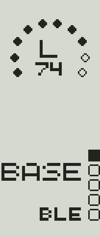
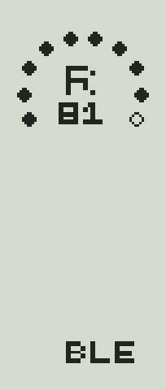

# nice-view-fork

A nice!view status screen for split ZMK keyboards, inspired by the arc style (style 2) of the
[beekeeb Toucan2](https://github.com/beekeeb/zmk-keyboard-toucan2), which is itself a fork of
[nice-view-gem](https://github.com/M165437/nice-view-gem).

The Toucan2 draws on a 144x168 panel. This fork adapts its layout to the 160x68 nice!view used
in portrait (68x160): one battery arc per half, a 16-column WPM chart instead of 30, the layer
name in QuinqueFive 12 instead of 18, and the screen drawn on three rotated 68x68 canvases.

| Central (L) | Peripheral (R) |
|---|---|
|  |  |

**Central (L)**: battery arc, WPM chart, layer name, output (`USB`/`BLE`/`NULL`) and
5 Bluetooth profiles. Layer names up to 4 characters use the large font, longer ones the small
font, truncated to 5.

**Peripheral (R)**: battery arc and connection to the central (`BLE`/`NULL`). Rows 60 to 134 are
left free for a mascot.

The number and dots inside each arc are that half's battery: 10 dots, one per 10 %, filled dots
are the charge left.

WPM is only shown on the central, as the dot chart: one column per reading, 6 rows for
0–100 WPM, no number. Keys from both halves are processed there, so it already
counts both. ZMK raises a WPM event only when the value changes, and each event adds a column
to the chart.

Both branches render the same pixels. The GIFs were rendered by the real LVGL on the host.

## Branches

| Branch | ZMK | LVGL |
|---|---|---|
| `main` | `main` | 9 |
| `v0.3` | `v0.3` | 8 |

## Usage

`config/west.yml`:

```yaml
manifest:
  remotes:
    - name: zmkfirmware
      url-base: https://github.com/zmkfirmware
  projects:
    - name: zmk
      remote: zmkfirmware
      revision: main
      import: app/west.yml
    - name: nice-view-fork
      url: <this repository>
      revision: main
  self:
    path: config
```

Use `revision: v0.3` for both projects on ZMK v0.3.

`build.yaml`:

```yaml
include:
  - board: nice_nano_v2
    shield: <keyboard>_left nice_view_adapter nice_view_fork
  - board: nice_nano_v2
    shield: <keyboard>_right nice_view_adapter nice_view_fork
```

## Configuration

| Option | Description | Default |
|---|---|---|
| `CONFIG_NICE_VIEW_WIDGET_INVERTED` | Light pixels on a dark screen | n |

## License

MIT, see [LICENSE](LICENSE). The embedded QuinqueFive font is by GGBotNet, under the
SIL Open Font License 1.1, see [QuinqueFive_License.txt](QuinqueFive_License.txt).
